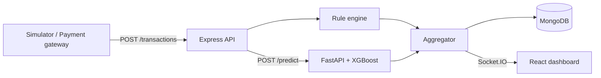

# 🛡️ Fraud Monitor

A full-stack, real-time credit card fraud detection platform. Every transaction is scored by a configurable rule engine and an XGBoost machine learning model, then approved, sent for review, or blocked, with the full decision streamed live to a dashboard.


🔗 **Live Demo:** [fraud-monitor.vercel.app](https://fraud-monitor.vercel.app)

> The backend and ML service run on Render's free tier and sleep after 15 minutes idle. The first request can take about 30 seconds. Open the link, click a scenario in the **Try it** tab, and give it a moment to wake up.

## 📋 Overview

Fraud Monitor is a payment fraud screening system built from three services: an Express API that receives transactions, a FastAPI service that serves an XGBoost fraud model, and a React dashboard that shows every decision in real time over Socket.IO.

Each transaction gets a score from two sources:

- **Rule engine** (up to 60 points): velocity spikes, amount anomalies, blocked countries and card-testing patterns, all editable at runtime.
- **ML model** (up to 40 points): the fraud probability from an XGBoost classifier trained on the Kaggle credit card fraud dataset.

The combined score decides the outcome: **APPROVED**, **REVIEW** or **BLOCKED**. Hard-block rules and very high-confidence ML scores can block a transaction on their own.

## ✨ Features

### 🔍 Fraud Detection

- Hybrid scoring that combines rule-based and machine learning signals
- Four rules: velocity spike, amount anomaly (against the user's 30-day average), blocked country and card-testing pattern
- Hard-block rules that force a block at score 100
- Auto-block when the ML probability passes a configurable threshold
- Graceful fallback to a neutral ML score if the ML service is unreachable, clearly flagged in the UI

### 📊 Real-Time Dashboard

- Live transaction feed streamed over Socket.IO
- KPI cards and a fraud chart that refresh every few seconds
- Alerts panel for all flagged (review and blocked) transactions
- Risk drawer with the score breakdown, rules triggered, ML probability and the reason for the decision

### 🧪 Try It Panel

- Send test transactions through the live pipeline with one click
- Four scenarios: normal purchase, known fraud pattern, blocked country and a card-testing burst
- Uses real held-out rows from the test set, never rows the model was trained on

### ⚙️ Rule Management

- Enable or disable each rule
- Edit thresholds at runtime, no redeploy needed
- Mark any rule as a hard block
- Manage the blocked country list
- Settings are saved in MongoDB and apply to the next transaction

### 🔒 API Hardening

- Schema validation with Zod
- API-key authentication for ingestion and admin writes
- Rate limiting on the demo endpoint
- Helmet security headers and CORS allowlist
- Structured logging and graceful shutdown
- Server-computed fields (status, score) can never be set by clients

## 🏗️ Architecture



### Decision Logic

| Component                 | Contribution                               |
| ------------------------- | ------------------------------------------ |
| Rule engine               | 20 points per triggered rule, capped at 60 |
| ML model                  | fraud probability × 40                     |
| Hard-block rule triggered | Score forced to 100, status BLOCKED        |
| ML probability ≥ 0.95     | BLOCKED (high-confidence ML score)         |
| Final score ≥ 71          | BLOCKED                                    |
| Final score ≥ 31          | REVIEW                                     |
| Otherwise                 | APPROVED                                   |

All thresholds are editable from the Rules tab.

## 🛠️ Tech Stack

### Frontend

- **React** with **Vite**: component-based UI
- **Socket.IO Client**: live transaction stream
- **Axios**: HTTP client

### Backend

- **Node.js** and **Express.js**: REST API
- **MongoDB** with **Mongoose**: transactions, alerts and rule configuration
- **Socket.IO**: real-time events
- **Zod**: request validation
- **Helmet**, **CORS** and **express-rate-limit**: API security
- **Node test runner** and **Supertest**: automated tests

### ML Service

- **FastAPI** and **Uvicorn**: model serving
- **XGBoost**: live fraud classifier
- **Isolation Forest**: anomaly detection baseline for comparison
- **scikit-learn**, **pandas**, **NumPy** and **joblib**: training and preprocessing

### DevOps

- **GitHub Actions**: CI for backend tests and the frontend build
- **Render**: backend and ML service hosting
- **Vercel**: frontend hosting
- **MongoDB Atlas**: cloud database

## 🤖 Machine Learning

- **Dataset:** [Credit Card Fraud Detection](https://www.kaggle.com/datasets/mlg-ulb/creditcardfraud) from Kaggle (ULB Machine Learning Group). It contains 284,807 transactions, of which only 492 are fraud, with anonymized features `V1` to `V28` plus `Time` and `Amount`.
- **Live model:** XGBoost classifier, with `Time` and `Amount` scaled before prediction.
- **Baseline:** Isolation Forest, trained for comparison.
- **Evaluation:** held-out test set, with the decision threshold chosen from a threshold sweep.

| Metric    | Value            |
| --------- | ---------------- |
| Precision | _add your value_ |
| Recall    | _add your value_ |
| ROC-AUC   | _add your value_ |

> Replace these with the numbers from your latest `train_model.py` run.

## 🚀 Getting Started

### Prerequisites

- Node.js (v22 recommended)
- Python 3.12 or newer
- A MongoDB database (local or MongoDB Atlas)
- The Kaggle `creditcard.csv` file, only needed if you want to retrain the model

### Installation

**1. Clone the repository**

```bash
git clone https://github.com/Vyom01p/Fraud-Monitor.git
cd Fraud-Monitor
```

**2. Set up the ML service**

```bash
cd ml-service
python -m venv venv
venv\Scripts\activate        # Windows
# source venv/bin/activate   # macOS / Linux
pip install -r requirements.txt
```

The trained model files are included in the repository. To retrain, download `creditcard.csv` from Kaggle into `ml-service/data/` and run:

```bash
python train_model.py
```

**3. Install backend dependencies**

```bash
cd ../backend
npm install
```

**4. Install frontend dependencies**

```bash
cd ../frontend
npm install
```

**5. Environment configuration**

Create `backend/.env`:

```env
# Server
PORT=5000
NODE_ENV=development

# Database
MONGO_URI=mongodb://127.0.0.1:27017/fraud_detection

# ML service
ML_SERVICE_URL=http://localhost:8000
ML_API_KEY=your-ml-api-key
ML_TIMEOUT_MS=8000

# Auth keys
INGEST_API_KEY=your-ingest-api-key
ADMIN_API_KEY=your-admin-api-key

# CORS
CLIENT_URL=http://localhost:5173
```

Create `ml-service/.env` (or set the variable in your shell):

```env
ML_API_KEY=your-ml-api-key
```

Create `frontend/.env` (optional, defaults to `http://localhost:5000`):

```env
VITE_API_URL=http://localhost:5000
```

`ML_API_KEY` must be identical in the backend and the ML service.

**6. Start the application**

Run each in its own terminal, in this order:

```bash
# Terminal 1: ML service
cd ml-service
venv\Scripts\activate
uvicorn main:app --port 8000

# Terminal 2: Backend
cd backend
npm run dev

# Terminal 3: Frontend
cd frontend
npm run dev

# Terminal 4: Transaction simulator
cd simulator
npm start
```

Open `http://localhost:5173`. The simulator streams transactions into the dashboard. You can also use the **Try it** tab.

### Running Tests

```bash
cd backend
npm test
```

23 tests cover the decision logic, request validation and the HTTP layer.

## 📁 Project Structure

```
Fraud-Monitor/
│
├── frontend/
│   ├── src/
│   │   ├── components/        # KpiCards, FraudChart, TransactionFeed,
│   │   │                      # AlertsPanel, RiskDrawer, TryItPanel, RuleManager
│   │   ├── context/           # SocketContext (live data + history)
│   │   ├── hooks/             # useSocket, useStats
│   │   ├── config.js          # API URL
│   │   ├── App.jsx
│   │   └── main.jsx
│   ├── public/
│   └── package.json
│
├── backend/
│   ├── src/
│   │   ├── config/            # Environment configuration
│   │   ├── controllers/       # Transaction, demo, stats and rule controllers
│   │   ├── middleware/        # Validation, API-key auth, error handling
│   │   ├── routes/            # API routes
│   │   ├── services/          # Pipeline, rule engine, aggregator, rule config
│   │   ├── validation/        # Zod schemas
│   │   ├── data/              # Demo samples (held-out test rows)
│   │   ├── app.js
│   │   └── server.js
│   └── package.json
│
├── ml-service/
│   ├── main.py                # FastAPI app (/health, /predict)
│   ├── train_model.py         # Training and evaluation script
│   ├── *.joblib               # Trained model, scalers and feature list
│   └── requirements.txt
│
├── simulator/                 # Transaction generator for demos
├── .github/workflows/ci.yml   # GitHub Actions CI
├── .gitignore
└── README.md
```

## 🔌 API Endpoints

### Transactions

```
POST /api/v1/transactions         # Score a transaction (requires x-api-key)
GET  /api/v1/transactions         # List recent transactions
GET  /api/v1/transactions/stats   # Dashboard statistics
POST /api/v1/transactions/demo    # Run a demo scenario (rate limited)
```

### Rules

```
GET /api/v1/rules                 # Get the current rule configuration
PUT /api/v1/rules                 # Update rules (requires x-admin-key)
```

### System

```
GET /health                       # Health check
```

### ML Service

```
GET  /health                      # Health check
POST /predict                     # Fraud probability for a transaction (requires API key)
```

### Real-Time Events (Socket.IO)

```
transaction_processed             # Every scored transaction
```

### Example Request

```bash
curl -X POST http://localhost:5000/api/v1/transactions \
  -H "Content-Type: application/json" \
  -H "x-api-key: your-ingest-api-key" \
  -d '{"userId":"user_1","amount":49.99,"ip":"1.2.3.4","billingCountry":"IN"}'
```

## ☁️ Deployment

| Service    | Platform                                         |
| ---------- | ------------------------------------------------ |
| Frontend   | Vercel (root directory `frontend`, Vite preset)  |
| Backend    | Render web service (root directory `backend`)    |
| ML service | Render web service (root directory `ml-service`) |
| Database   | MongoDB Atlas                                    |

Deploy in this order: ML service, backend, frontend, then update the backend's `CLIENT_URL` to the final frontend URL so CORS allows it.

**Backend environment variables:** `NODE_ENV`, `MONGO_URI`, `ML_SERVICE_URL`, `ML_API_KEY`, `INGEST_API_KEY`, `ADMIN_API_KEY`, `CLIENT_URL`, `ML_TIMEOUT_MS`.

**ML service environment variables:** `PYTHON_VERSION`, `ML_API_KEY`.

**Frontend environment variable:** `VITE_API_URL` (the backend URL, set before building).

## ⚠️ Limitations

This is a portfolio project, and I want to be upfront about what it does and doesn't do:

- The model is trained on a public dataset with anonymized `V1` to `V28` features. Live traffic outside the replay set can't supply those features, so such transactions are scored mostly by the rules.
- Demo and simulator data are real held-out rows, but transaction volume and user behavior are simulated.
- The dashboard has no user login. Writes are protected by API keys, while reads and the socket stream are public.
- Tests cover decision logic, validation and the HTTP layer, not the MongoDB-backed rule queries.
- The 60/40 rule-to-ML weighting is a tunable starting point, not calibrated against production outcomes.

## 🔒 Security Features

- **API-Key Authentication:** separate keys for ingestion and admin actions
- **Input Validation:** Zod schemas on every write endpoint
- **Rate Limiting:** applied to the public demo endpoint
- **Security Headers:** Helmet defaults
- **CORS Allowlist:** only the configured frontend origins
- **Environment Variables:** secrets are kept out of source code
- **Server-Side Scoring:** clients can't inject status or score fields

## 📝 License

This project is licensed under the MIT License.

## 🙏 Acknowledgments

- [ULB Machine Learning Group](https://www.kaggle.com/datasets/mlg-ulb/creditcardfraud) for the Credit Card Fraud Detection dataset on Kaggle
- XGBoost and scikit-learn for the machine learning tooling
- Socket.IO for the real-time layer
- The open-source community for the amazing tools that made this possible
